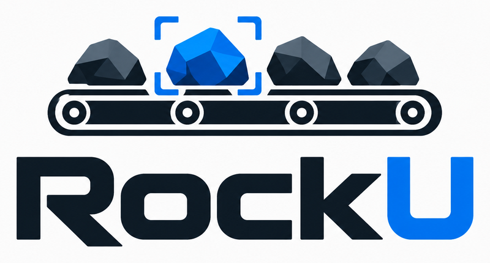

<p align="center">
  
</p>

<h1 align="center">RockU: monitoreo de correas transportadoras</h1>

Prototipo a escala de un sistema de monitoreo para correas transportadoras de minería en Latinoamérica. Detecta tres situaciones que suelen causar detenciones no planificadas:

- Correa detenida
- Desalineación lateral
- Paso de un objeto o piedra

Proyecto del Taller de Innovación (UAI). Esta es la parte técnica del prototipo: visión por computador sobre una correa a escala, con un teléfono Android como cámara y una Raspberry Pi como nodo de análisis.

## Cómo funciona

```
                 HTTP /capture                  POST /event
 Teléfono Android ---------------> Raspberry Pi <---------------- ESP32 + HC-SR04
 (app CorreaCam,                   (análisis, estados,           (detecta objeto,
  cámara con 3A bloqueado)          SQLite, panel web,            solo distancia)
                                    pantalla 3.5", CSV)
```

1. La app del teléfono sirve frames JPEG por HTTP con exposición, balance de blancos y enfoque bloqueados.
2. La Pi pide frames a ~10 fps y mide:
   - **Velocidad y detención:** correlación de fase (`cv2.phaseCorrelate`) entre frames consecutivos sobre la zona de la correa.
   - **Alineación:** posición y ángulo de las dos líneas longitudinales impresas en la correa, contra una referencia calibrada.
3. Una máquina de estados con confirmación por persistencia decide: `CALIBRANDO`, `NORMAL`, `DETENIDA`, `DESALINEADA`, `OBJETO_DETECTADO`, `SIN_SENAL`.
4. El sensor ultrasónico HC-SR04, conectado al ESP32, avisa a la Pi cuando pasa un objeto.
5. La Pi registra todo en SQLite y lo expone en un panel web, una pantalla táctil y exportación a CSV (USB o descarga web).

En la demo final la Pi actúa como punto de acceso WiFi, con IPs fijas para el teléfono y el ESP32.

## Estado del proyecto

| Componente | Estado |
|---|---|
| Raspberry Pi 4 con Raspberry Pi OS 64-bit, SSH, OpenCV, Flask | Listo |
| App Android (captura, `/status`, `/config`, bloqueo 3A, exposición manual) | Listo |
| Scripts de grabación y análisis offline, con simulador de correa | Listo, probado con imágenes sintéticas |
| Prueba con la correa real y ajuste de umbrales | Pendiente |
| Integración captura, análisis, estados y SQLite | Pendiente |
| Panel web, pantalla 3.5" y simulador en el navegador | Listo |
| Servidor Flask con API, SSE, SQLite y exportación CSV | Listo, probado con simulador y teléfono falso |
| Firmware ESP32 con HC-SR04 y eventos | Pendiente |
| Pi como punto de acceso WiFi | Pendiente |

## Hardware

- Raspberry Pi 4 Model B, microSD de 32 GB
- Teléfono Android (probado con Samsung S25 Ultra) como cámara
- ESP32-CAM usado solo como nodo de distancia, con sensor HC-SR04
- Pantalla 3.5" SPI con touch XPT2046 (modelo exacto por confirmar)
- Correa a escala con marcas (ver más abajo)

## Estructura del repositorio

```
app/            App Android (Kotlin, CameraX, NanoHTTPD)
pi/             Código para la Raspberry Pi (Python)
  deteccion.py    Velocidad, alineación, calibración y clasificador de estados
  grabar.py       Graba frames etiquetados desde el teléfono
  analizar.py     Modos medir, calibrar y evaluar sobre grabaciones
  simulador.py    Genera correas sintéticas para probar los algoritmos
  test_sintetico.py  Suite de pruebas con imágenes sintéticas
  servidor.py     Servidor Flask: API, stream SSE, panel y CSV
  fuentes.py      Fuente simulada y fuente real (teléfono, detector, ESP32)
  registro.py     Registro SQLite y exportación CSV
  test_servidor.py  Pruebas del servidor
  dashboard/      Panel web y pantalla de 3.5"
docs/           Plan del sistema (plan_sistema_deteccion.md)
```

## La correa a escala

El algoritmo depende de estas marcas, así que conviene respetarlas:

- Ancho 15 cm, largo mínimo 60 cm, blanca mate, sobre fondo oscuro mate.
- Dos líneas negras longitudinales de 8 mm, a 10 mm de cada borde. Sirven para medir la alineación y la escala (la separación entre centros es 122 mm).
- Marcas transversales negras de 6 mm con separaciones irregulares de 35, 62, 48, 85, 41, 70, 55 y 38 mm (periodo de 434 mm). El periodo es mayor que el campo visual para que no haya ambigüedad.
- 6 a 8 puntos negros de 5 mm entre las marcas.
- Nada más pequeño que 5 mm.
- Teléfono a 25 a 30 cm sobre la correa, mirando hacia abajo, con el avance de la correa a lo largo del lado largo de la imagen.
- Dos lámparas LED de corriente continua a unos 45 grados. Las luces alimentadas con corriente alterna parpadean a 50 Hz y afectan la imagen.
- Velocidad de la correa entre 5 y 15 cm/s.

## Puesta en marcha

### 1. App del teléfono

1. Abrir la carpeta del repositorio en Android Studio y compilar `app`.
2. Instalar en el teléfono y otorgar permisos de cámara y notificaciones.
3. Pulsar el botón de inicio. La app muestra la IP y el puerto (8080).
4. Desde un navegador en la misma red abrir `http://IP_DEL_TELEFONO:8080/`. Desde ahí se bloquea el 3A (exposición, balance de blancos y enfoque) y se puede fijar la exposición manual.

Endpoints:

| Ruta | Descripción |
|---|---|
| `/` | Página de control con imagen en vivo |
| `/capture` | Último frame en JPEG |
| `/status` | Estado en JSON (resolución, fps, bloqueo) |
| `/config` | Parámetros: `lock=1\|0`, `exp=<ms>\|auto`, `iso`, `quality`, `maxfps`, `rot` |

### 2. Raspberry Pi

Requisitos: Raspberry Pi OS 64-bit, `python3-opencv`, `python3-numpy`, `python3-requests`, `python3-flask`.

```bash
sudo apt install python3-opencv python3-numpy python3-requests python3-flask
scp -r pi/*.py usuario@host.local:~/correa/
```

### 3. Grabar y calibrar

Con el 3A bloqueado en el teléfono y la correa armada:

```bash
cd ~/correa
python3 grabar.py normal --segundos 20 --url http://IP_DEL_TELEFONO:8080
python3 grabar.py detenida --segundos 10 --url http://IP_DEL_TELEFONO:8080
python3 grabar.py desalineada_izq --segundos 15 --url http://IP_DEL_TELEFONO:8080

python3 analizar.py calibrar videos/normal_<fecha> --detenida videos/detenida_<fecha> -o calibracion.json
python3 analizar.py evaluar videos/desalineada_izq_<fecha> -c calibracion.json
```

`analizar.py` recibe una sola carpeta por comando; reemplaza `<fecha>` por la carpeta concreta que creó `grabar.py`.

`grabar.py` guarda cada grabación en `videos/<etiqueta>_<fecha>/` con los frames, `indice.csv` y `meta.json`, y avisa si el 3A no está bloqueado.

### 4. Probar sin hardware

```bash
cd pi
python3 test_sintetico.py
```

Genera 11 escenarios sintéticos (distintas velocidades, detenida, desalineaciones, transición entre estados), calibra y evalúa. Requiere `numpy` y `opencv-python`.

### 5. Servidor web, panel y pantalla

El servidor Flask (`pi/servidor.py`) sirve el panel (`pi/dashboard/`), la API, el stream en vivo (SSE) y las exportaciones CSV. Registra muestras y eventos en SQLite. La API está en [`docs/api.md`](docs/api.md).

```bash
pip install -r pi/requirements.txt        # en la Pi: sudo apt install python3-flask python3-opencv python3-numpy python3-requests
cd pi

# Simulador, sin teléfono ni correa (panel en http://IP_DE_LA_PI:5000/)
python3 servidor.py --fuente sim

# Correa real: teléfono con CorreaCam, ESP32 y calibración guardada
python3 servidor.py --fuente real --telefono http://192.168.1.84:8080 --calibracion calibracion.json
```

- Panel completo: `http://IP_DE_LA_PI:5000/`. Pantalla de 3.5": `http://localhost:5000/mini`.
- Sin `calibracion.json` la fuente real parte en `CALIBRANDO`. Con la correa en condición normal, pulsa Calibrar en el panel o en la pantalla: mide unos segundos, guarda el archivo y sigue sola.
- El ESP32 avisa los objetos con `POST /event` y el cuerpo `{"distancia_mm": 74, "n": 12}`. La Pi pide una foto al teléfono en ese instante y la guarda en `fotos/`.
- Exportación: `/export/eventos.csv` y `/export/muestras.csv`, con `?desde=<ms>&hasta=<ms>&sep=;`. UTF-8 con BOM, para abrir directo en Excel.
- La base de datos queda en `rockU.db` (en sim, `rockU_sim.db`). Se conservan 30 días de muestras (`--dias-muestras`).
- Pruebas: `python3 pi/test_servidor.py`.

**Pantalla en modo kiosco (Raspberry Pi OS con labwc).** Agrega esta línea a `~/.config/labwc/autostart`:

```bash
chromium --kiosk --noerrdialogs --disable-infobars --check-for-update-interval=31536000 http://localhost:5000/mini &
```

Con escritorio X11 (`~/.config/lxsession/LXDE-pi/autostart`), la misma línea con `@` al inicio. Para que el servidor arranque solo, usa el servicio de ejemplo [`docs/rockU.service`](docs/rockU.service):

```bash
sudo cp docs/rockU.service /etc/systemd/system/
sudo systemctl enable --now rockU
```

## Resultados con imágenes sintéticas

Simulación de 1080x1440 px a 10 fps, con desenfoque de movimiento, ruido, JPEG, gradiente de luz y fondo estático:

- Error de velocidad menor a 1.2% entre 60 y 150 mm/s.
- Desalineación medida con error menor a 0.1 mm y 0.1 grados en los casos de prueba.
- Precisión de estado de 100% en los 11 escenarios, sin falsas alarmas a otras velocidades.
- Reacción de 0.6 s ante una detención y 0.2 s ante una desalineación.

Son resultados de simulación. Falta validarlos con la correa real.

## Mejoras futuras

- Cámara CSI de la Raspberry Pi en lugar del teléfono.
- Detección de rasgaduras y cuerpos extraños pequeños.
- Modelos de aprendizaje automático para clasificación de objetos.

## Documentación

El diseño completo, los riesgos y el orden de trabajo están en [`docs/plan_sistema_deteccion.md`](docs/plan_sistema_deteccion.md).

## Licencia

Distribuido bajo la licencia MIT. Ver [`LICENSE`](LICENSE).
