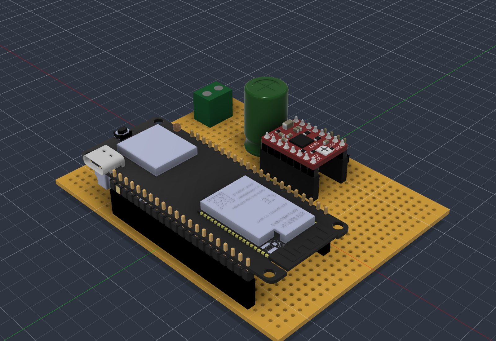
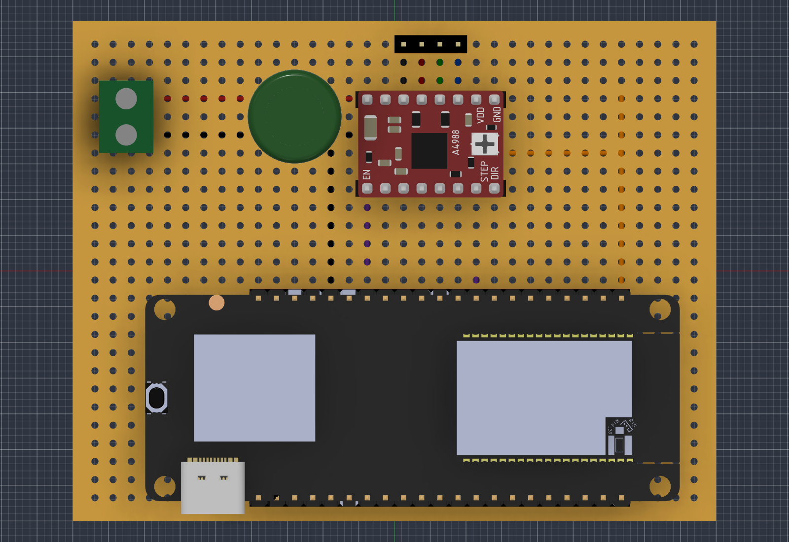
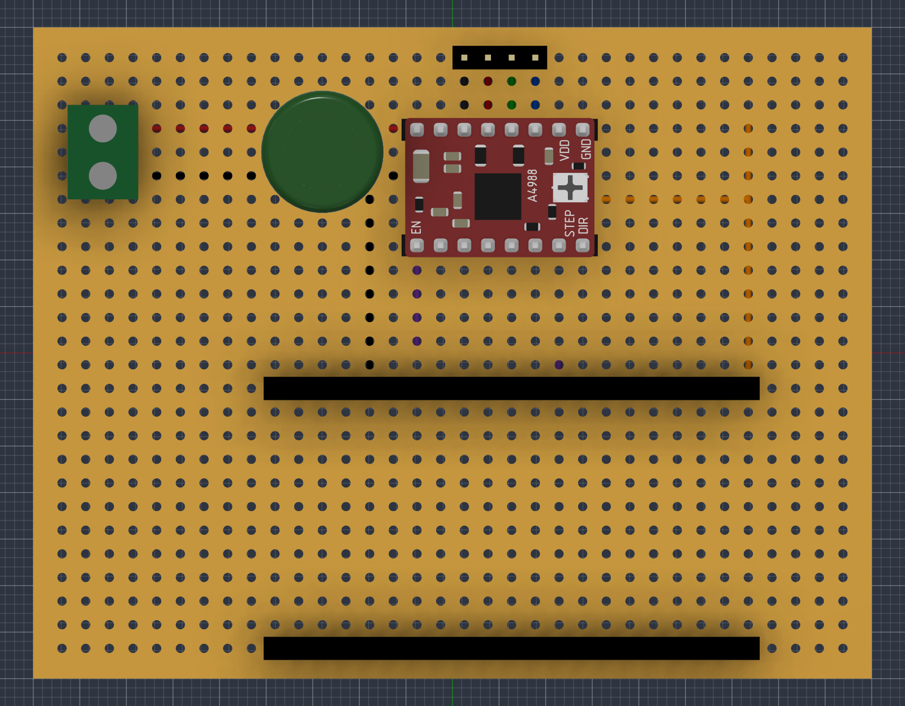
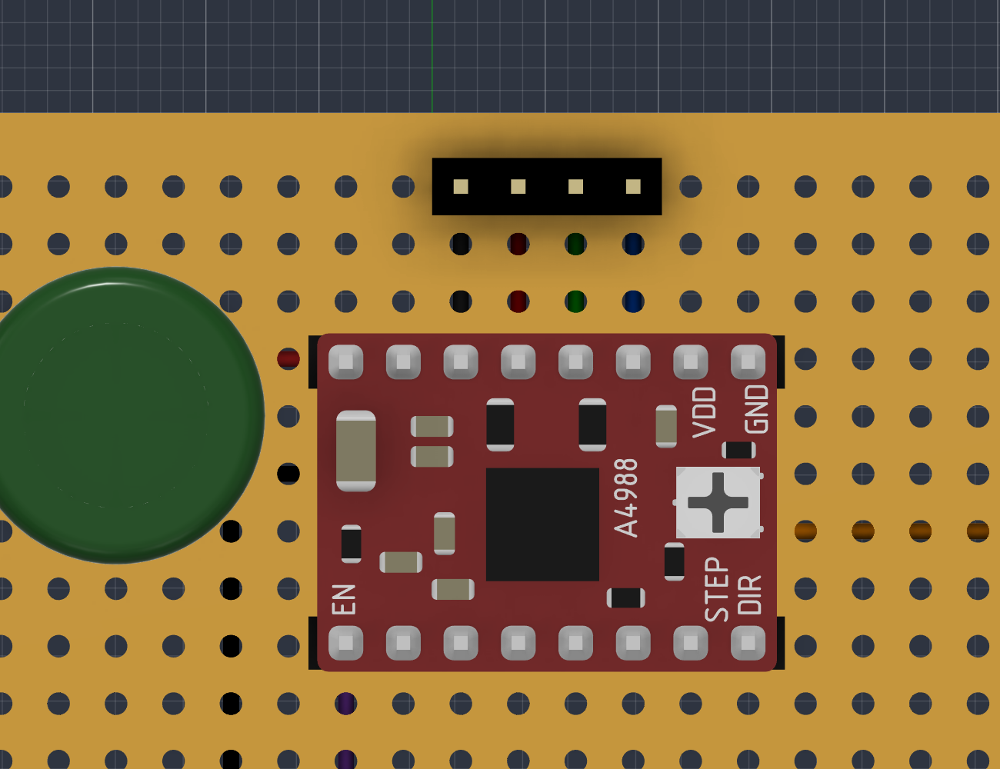
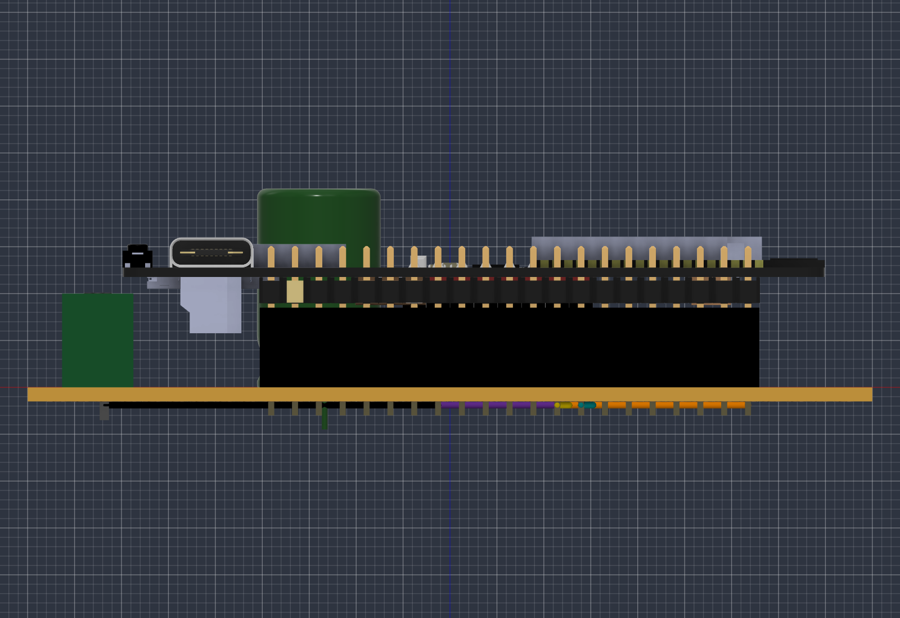
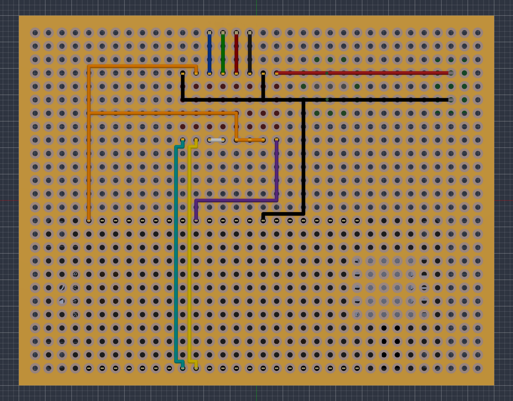
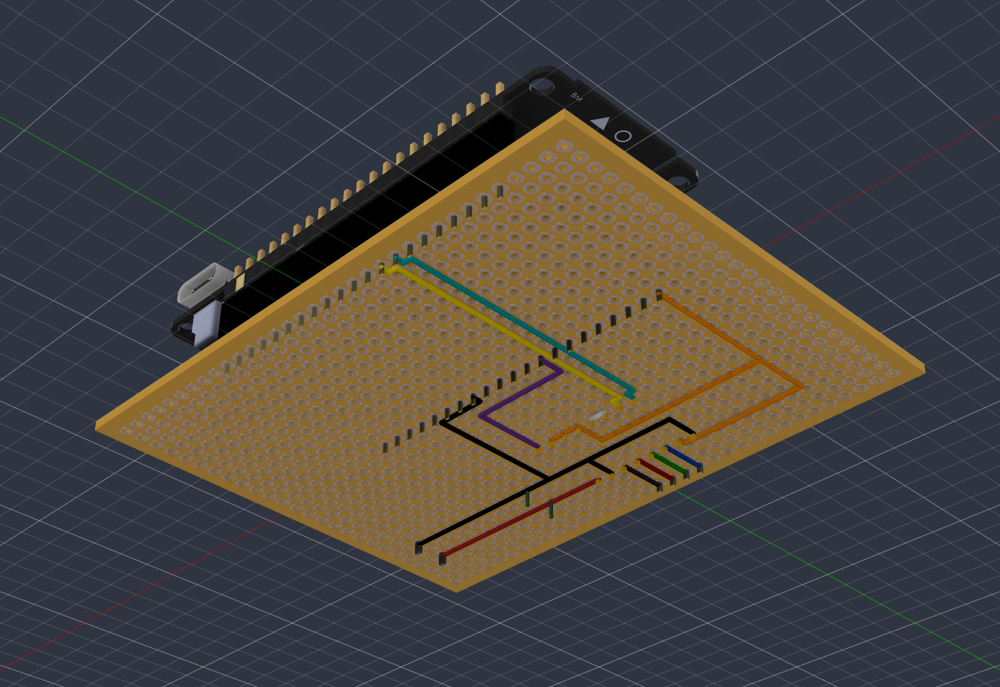

# Perfboard del controlador del motor de la correa

Placa de control del motor paso a paso de la correa transportadora a escala (Taller de Innovación, UAI). Una ESP32 TTGO T-Call genera los pulsos y un driver A4988 (clon HR4988) mueve un motor Minebea 17PM-K374BN02CN alimentado con 12 V.

Este documento explica dónde va cada componente en la perfboard, qué se conecta con qué y por qué. Modelo 3D en Fusion: `Perfboard controlador motor`.



## Componentes

| Ref | Componente | Nota |
|---|---|---|
| U1 | ESP32 TTGO T-Call V1.4 (SIM800L) | Montada en sockets, se alimenta por su USB-C |
| U2 | Driver A4988 / HR4988 | Montado en sockets, Rs = 0.10 Ω, Vref = 0.24 V |
| S1, S2 | Sockets hembra 1x8 | Para el driver |
| S3, S4 | Sockets hembra 1x21 | Para la TTGO |
| TB1 | Bornera de tornillo 2 pines, paso 5.08 mm | Entrada de 12 V |
| C1 | Condensador electrolítico 100 µF 25 V | Entre VMOT y GND, cerca del driver |
| J1 | Header macho 1x4 | Salida al motor |
| - | Perfboard de pads individuales 70 x 90 mm | Grilla de 34 x 26 agujeros, paso 2.54 mm |

Nota: en el modelo 3D el condensador se ve más grande porque se usó un modelo de 1000 µF como referencia visual. El real es de 100 µF 25 V.

## Sistema de coordenadas

Todas las posiciones se dan como (columna, fila), mirando la placa desde arriba (lado de los componentes):

- Columnas 1 a 34 de izquierda a derecha (lado largo, 90 mm). La columna 1 es el lado de la bornera.
- Filas 1 a 26 de arriba hacia abajo (lado corto, 70 mm). La fila 1 es el lado de J1 y la fila 26 el del USB-C.



## Ubicación de los componentes

| Componente | Posición |
|---|---|
| TB1 | + en (3,4), GND en (3,6). Entrada de cables hacia el borde izquierdo |
| C1 | + en (12,4), - en (12,6) |
| S2 (potencia del driver) | Fila 4, columnas 16 a 23 |
| S1 (lógica del driver) | Fila 9, columnas 16 a 23 |
| J1 | Fila 1, columnas 18 a 21 |
| S3 (fila izquierda de la TTGO: 3V3, EN, VP...) | Fila 15, columnas 10 a 30 |
| S4 (fila derecha de la TTGO: GND, 23, 22...) | Fila 26, columnas 10 a 30 |



### Driver

La serigrafía del driver queda así: EN, STEP y DIR en la fila 9, VDD y GND en la fila 4. Las dos filas del A4988 están a 12.7 mm, es decir a **5 agujeros** (filas 4 y 9).

| Columna | 16 | 17 | 18 | 19 | 20 | 21 | 22 | 23 |
|---|---|---|---|---|---|---|---|---|
| Fila 4 (S2) | VMOT | GND | 2B | 2A | 1A | 1B | VDD | GND |
| Fila 9 (S1) | EN | MS1 | MS2 | MS3 | RESET | SLEEP | STEP | DIR |



### TTGO

La TTGO va girada, con el USB-C hacia el borde inferior para poder conectarla con la placa montada (y después dentro de la caja). El pin del extremo del lado del ESP32 queda en la columna 30, así que **columna = 30 - n**, donde n es la posición del pin contando desde ese extremo (n = 0 a 20).

Pines usados:

| Pin TTGO | Fila | n | Posición |
|---|---|---|---|
| 3V3 | Izquierda | 0 | (30,15) |
| GPIO25 | Izquierda | 8 | (22,15) |
| GND | Izquierda | 13 | (17,15) |
| GPIO19 | Derecha | 7 | (23,26) |
| GPIO18 | Derecha | 8 | (22,26) |



## Conexiones

Todos los cables van por la cara inferior (cobre). Los colores son los del modelo 3D.

| Red | Color | Conecta | Por qué |
|---|---|---|---|
| +12 V | Rojo | TB1 + (3,4), C1 + (12,4), VMOT (16,4) | Alimentación del motor. VMOT acepta 8 a 35 V |
| GND | Negro | TB1 - (3,6), C1 - (12,6), GND potencia (17,4), GND lógica (23,4), GND TTGO (17,15) | Una sola tierra común. Sin ella, STEP y DIR no tienen referencia y el driver no los lee bien |
| 3V3 | Naranja | 3V3 TTGO (30,15), VDD (22,4), MS1, MS2 y MS3 (17 a 19, fila 9) | VDD a 3.3 V hace que los niveles lógicos del driver coincidan con los de la ESP32. MS1 a MS3 en alto ponen el driver en micropaso 1/16 |
| RESET-SLEEP | Blanco | RESET (20,9) con SLEEP (21,9) | RESET no tiene pull-up interno. Unido a SLEEP (que sí lo tiene) el driver queda siempre activo |
| EN | Morado | EN (16,9) a GPIO25 (22,15) | Permite apagar las bobinas por software (activo en LOW) |
| STEP | Amarillo | STEP (22,9) a GPIO18 (22,26) | Cada pulso avanza un micropaso |
| DIR | Cian | DIR (23,9) a GPIO19 (23,26) | Sentido de giro |
| Motor | Negro, rojo, verde, azul | 2B, 2A, 1A, 1B (fila 4, cols 18 a 21) a J1 (fila 1, cols 18 a 21) | Bobina A = verde y azul, bobina B = negro y rojo |

Recorridos (columna, fila). Los valores .5 pasan entre agujeros:

| Red | Recorrido |
|---|---|
| +12 V | (3,4) → (16,4) |
| GND | (3,6) → (23,6) → (23,4). Ramal (17,6) → (17,4). Ramal (14,6) → (14,14.5) → (17,14.5) → (17,15) |
| 3V3 | (30,15) → (30,3.5) → (22,3.5) → (22,4). Ramal (30,7) → (19,7) → (19,9) → (17,9) |
| EN | (16,9) → (16,13.5) → (22,13.5) → (22,15) |
| STEP | (22,9) → (22.5,9.5) → (22.5,25.5) → (22,26) |
| DIR | (23,9) → (23.5,9.5) → (23.5,25.5) → (23,26) |
| Motor | (18 a 21, 4) → (18 a 21, 1), rectos |

La vista inferior está espejada de izquierda a derecha, porque se mira la placa dada vuelta: la columna 1 queda a la derecha y la 34 a la izquierda. Las filas no cambian.





### Motor en J1

| J1 | Cable del motor | Pin del motor | Driver |
|---|---|---|---|
| (18,1) | Negro | 1 | 2B |
| (19,1) | Rojo | 3 | 2A |
| (20,1) | Verde | 4 | 1A |
| (21,1) | Azul | 6 | 1B |

Si el motor gira al revés, invertir los dos cables de una sola bobina (por ejemplo verde y azul), siempre con todo apagado.

### Condensador C1

El motor es una carga inductiva y el driver conmuta su corriente miles de veces por segundo. Eso genera picos de tensión en VMOT que pueden superar el máximo del A4988 y quemarlo. C1 absorbe esos picos, por eso va lo más cerca posible de VMOT. Es electrolítico: la pata larga (+) va a VMOT y la de la franja (-) a GND.

## Pines de la TTGO que no se usan

Según el pinout del fabricante, el módem SIM800L usa los GPIO 4 (PWKEY), 5 (reset), 23 (POWER), 26 (TX), 27 (RX), 32 (DTR) y 33 (RI). Por eso ENABLE va en **GPIO25** y no en GPIO32, como estaba en la primera versión. Los GPIO 21 y 22 se usan para el I2C del chip de carga de la placa.

## Configuración en el firmware

```cpp
#define PIN_STEP 18
#define PIN_DIR  19
#define PIN_EN   25   // antes 32 (DTR del SIM800L)

const int MICROSTEPS = 16;   // MS1, MS2 y MS3 a 3V3
```

## Ajuste del driver

- Vref = I x 8 x Rs. Para 0.3 A con Rs = 0.10 Ω, **Vref = 0.24 V**.
- Medir con el multímetro en DC, punta negra a GND y roja en el tornillo del potenciómetro, con solo la lógica alimentada.
- Si el motor salta pasos, subir de a 0.03 V sin pasar de 0.30 V. Si se calienta de más, bajar.

## Armado

1. Puentes y cables por la cara inferior.
2. Sockets S1 y S2 con el driver puesto como guía.
3. Sockets S3 y S4 con la TTGO puesta como guía.
4. J1 y TB1.
5. C1 al final, respetando la polaridad.

Revisión con el multímetro en continuidad, sin driver ni TTGO montados:

| Entre | Debe dar |
|---|---|
| VMOT (16,4) y GND (17,4) | Sin continuidad |
| 3V3 (30,15) y GND (17,15) | Sin continuidad |
| 3V3 (30,15) y VMOT (16,4) | Sin continuidad |
| TB1 + (3,4) y VMOT (16,4) | Continuidad |
| TB1 - (3,6) y GND TTGO (17,15) | Continuidad |
| STEP (22,9) y GPIO18 (22,26) | Continuidad |
| DIR (23,9) y GPIO19 (23,26) | Continuidad |
| EN (16,9) y GPIO25 (22,15) | Continuidad |

Si alguna falla, no energizar hasta corregirla.

## Encendido

1. Con los 12 V desconectados, montar el driver y la TTGO en sus sockets y conectar el motor a J1.
2. Conectar la TTGO por USB-C.
3. Conectar los 12 V en TB1.
4. Para apagar, desconectar primero los 12 V.
5. Nunca conectar ni desconectar el motor con los 12 V conectados.

## Pendiente de verificar

- La separación entre las dos filas de pines de la TTGO se tomó como 27.94 mm (11 agujeros), porque la placa ocupa de la fila "a" a la "j" en una protoboard estándar. El modelo 3D del fabricante indica 26.46 mm. Antes de soldar S3 y S4, presentarlos con la TTGO puesta.
- Interruptor de 12 V en el cable + (opcional, para la caja).
